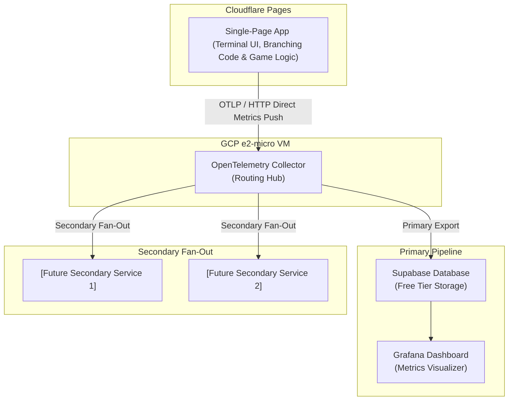

# Architecture Document: Single-Page Text Adventure & Multi-Destination Telemetry Pipeline

## System Overview

The application is structured as a client-side Single Page Application (SPA) deployed to Cloudflare Pages. It integrates game execution logic and branching code directly within the application, while leveraging a decoupled `content.json` payload strictly for narrative text and strings. Client-side telemetry is dispatched directly to an independent, multi-purpose OpenTelemetry (OTEL) collector hosted on a free-tier GCP e2-micro instance, which fans out metrics to primary storage and secondary analysis endpoints.

### 2. Component Architecture

- **Frontend UI Shell:**
  - Retro terminal emulator
  - Self-contained local state loop in the single-page application handling command inputs, text history output, and game state locally in the browser.
  - Provides a centered `Start Over` button outside and below the terminal console to reset game state to a fresh Stage 1 beginning while recording a `mysterious_disappearance` metric and flushing immediately if invoked during an active session.
- **Game Engine:**
  - Pure execution logic.
  - Handles state management, command parsing, inventory checks, condition evaluation, and dynamic DOM rendering without embedding narrative strings.
  - May define fixed UI-chrome labels (e.g., `CHOICE_PROMPT_HEADER` in `src/engine/prompt.ts`) as exported constants. These are not narrative content. All story, death, and parser text must still come from `content.json`.
  - No circular dependencies of any kind (imports, module references, or logic).
- **Check-Node Resolution (`src/engine/transition.ts`):**
  - `transition()` dispatches the input to the stage handler, then loops (max 10 steps) while the resulting node is in `AUTO_RESOLVE_NODES`, re-dispatching with empty input and concatenating output. Check nodes (respawn, periodicals, stacks door, flashlight, pocketknife, umbrella, etc.) therefore never rest as menus, and chained checks resolve in one call.
  - The periodicals gate (`stage2_periodicals_check`) requires the mop only (`inventory.includes("mop")`); the fireplace poker alone does not pass.
  - `stage2_respawn_check` evaluates weapon possession against the restored Stage 2 snapshot (`mop` routes to `stage2_foyer`; empty routes to `stage1_vestibule_searched` with hint text).
  - Unmatched input in stage 2 yields a parser fallback, not a death; deaths occur only on explicit choices (e.g., `go deeper` at `stage2_foyer`).
- **Inventory Snapshots & Stage Respawn / Retry (`src/engine/`):**
  - **Stage 2 Snapshot:** Captured upon entering `stage2_foyer` from Stage 1 (preserving `["mop"]` or `[]`).
  - **Stage 3 Snapshot:** Captured upon surviving arrival at `stage3_arrival` (requiring the fireplace poker) and transitioning to `stage3_hub_unexplored`.
  - **Stage 2 Death Retry:** Retrying from `stage2_death_choice` restores `stage2InventorySnapshot` and routes into `stage2_respawn_check`. If the snapshot contains the mop, the player respawns at `stage2_foyer`. If no mop was brought, the player lands at `stage1_vestibule_searched` with the hint text and restored empty snapshot. Any items gathered during Stage 2 (fireplace poker, stacks key, corpse loot, desk items) are discarded on respawn.
  - **Stage 3 Arrival Death Retry:** Dying to the arrival ambush (entering with the mop instead of the poker) transitions to `stage3_early_death_choice`. Retrying before a Stage 3 snapshot is captured restores `stage2InventorySnapshot` and routes through `stage2_respawn_check` to `stage2_foyer` (or `stage1_vestibule_searched` if mopless), preventing soft-locks and allowing the player to retrieve the poker.
  - **Stage 3 Early Post-Arrival Death Retry (`stage3_early_death_choice`):** Dying after surviving arrival before exploring the hub (selecting `go deeper` at `stage3_hub_unexplored` or `stage3_foyer_blocked`) restores `stage3InventorySnapshot` and respawns the player at `stage3_hub_unexplored`.
  - **Stage 3 Hub & Row Death Retry (`stage3_death_choice`):** Dying during hub or row explorations (or at `stage4_junction_c_check` without the pocketknife) preserves acquired Stage 3 items, resets all row peering flags (`row1_safe`–`row5_safe` to `false`), and respawns the player at `stage3_hub`.
- **Inventory Display (`src/engine/commands.ts`):**
  - `processCommand` emits a `sys` line `Inventory: ...` when inventory changes (pick up, search, fireplace) and on `look in the pack` at `stage1_pack_checked` and stage 2 search nodes.
- **Choice Prompt (`src/engine/prompt.ts`):**
  - Pure helpers that render the numbered `Do you want to:` list from `getAvailableChoices(nodeId)`; empty for terminal nodes.
  - `formatChoicePrompt(nodeId)` is appended to the initial output on load; `getTransitionPrompt(prev, next)` appends it after a transition only when `currentNode` changed.
  - The UI shell (`src/routes/index.tsx`) calls these helpers and does not build prompt text itself.
- **Content Payload (`content.json`):**
  - Fully populated and finalized data payload
- **Telemetry (`src/engine/telemetry.ts`):**
  - OpenTelemetry metrics instrumentation (`the-library-engine` meter) integrated into the game engine with graceful fallback when collectors are absent or unreachable.
  - Emits monotonic counters for completed runs (`game.runs.completed` with `outcome` and `final_stage` attributes) and fatal transitions (`game.deaths` with `stage`, `death_type` [`monster_attack`, `environmental_hazard`, `unknown_death`, `mysterious_disappearance`], and `node_id` attributes).
  - Exports metrics over OpenTelemetry Protocol (OTLP) Hypertext Transfer Protocol (HTTP) (`OTLPMetricExporter` targeting `https://collector.littlefuzzydinos.com/v1/metrics`) via a `PeriodicExportingMetricReader` (`5000ms` interval), and invokes `flushTelemetry()` (`meterProvider.forceFlush()`) on both `recordRunCompleted()` and `recordDeath()` so terminal outcomes and deaths flush immediately.

---

## Architecture Diagram

