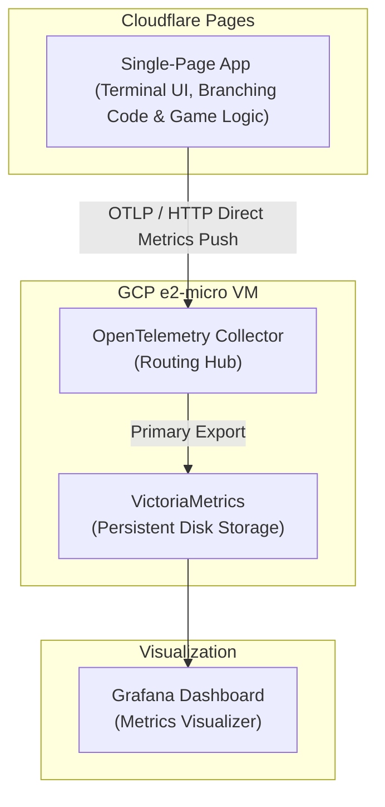

# Architecture Document: Single-Page Text Adventure & Telemetry Pipeline

## System Overview

The application is structured as a client-side Single Page Application (SPA) deployed to Cloudflare Pages. It integrates game execution logic and branching code directly within the application, while leveraging a decoupled `content.json` payload strictly for narrative text and strings. Client-side telemetry is dispatched directly to an OpenTelemetry (OTEL) collector hosted on a free-tier GCP e2-micro instance, which exports metrics to VictoriaMetrics backed by a persistent disk on the VM for visualization in Grafana.

## Strict 3-Tier Decoupling & Component Boundaries

### 1. Frontend UI Shell (`src/routes/`, `src/components/`)

- Presentational React interface simulating a retro terminal console with a self-contained local browser state loop handling command inputs, text history output, and active session state.
- Completely decoupled from game rules; never imports, parses, or inspects `content.json` directly and contains no embedded narrative logic.
- Connects interactive user input directly to the headless game engine (no leftover mock handlers).
- Renders a centered footer row outside and below the terminal console containing:
  - A `Start Over` button that resets game state to a fresh Stage 1 beginning (recording and immediately flushing a `mysterious_disappearance` metric if invoked during an active session).
  - An external `Count the lost ↗` link (`target="_blank"`, `rel="noopener noreferrer"`) opening the Grafana death-toll telemetry dashboard without interrupting active game state.

### 2. Headless Game Engine (`src/engine/`)

- Pure TypeScript execution logic handling state management, command parsing, inventory evaluation, stage transitions, and telemetry emission.
- Must remain 100% headless with zero React imports, zero DOM manipulation, and zero browser globals.
- Must contain zero hardcoded narrative strings, parser fallbacks, or literal death-screen keys. All story, death, and parser text must load dynamically from `content.json` (fixed UI-chrome labels such as choice prompt headers may be defined as exported constants).
- Zero circular dependencies across imports, module references, or state logic.

### 3. Narrative Content Catalog (`content.json`)

- Static string dictionary loaded dynamically by the engine via typed schemas.

## Telemetry Pipeline (`src/engine/telemetry.ts`)

- OpenTelemetry metrics instrumentation (`the-library-engine` meter) integrated into the game engine with graceful fallback when collectors are absent or unreachable.
- Configures `MeterProvider` with a `Resource` (`createTelemetryResource()`) setting `service.name` (`the-library`) and `deployment.environment` (from Vite `MODE`, `NODE_ENV`, or `production` fallback) merged onto `defaultResource()`.
- Emits monotonic counters for:
  - Completed runs (`game.runs.completed` with `outcome` and `final_stage` attributes).
  - Fatal transitions (`game.deaths` with `stage`, `death_type` [`monster_attack`, `environmental_hazard`, `unknown_death`, `mysterious_disappearance`], and `node_id` attributes).
- Exports metrics via `ImmediateMetricReader` (no periodic polling interval), invoking `flushTelemetry()` (`meterProvider.forceFlush()`) on both `recordRunCompleted()` and `recordDeath()` so metrics export immediately. `createMetricExporter()` selects `NoopMetricExporter` when `isTestEnvironment()` is true and `OTLPMetricExporter` targeting `https://collector.littlefuzzydinos.com/v1/metrics` over OpenTelemetry Protocol (OTLP) HTTP otherwise.

## Architecture Diagram

