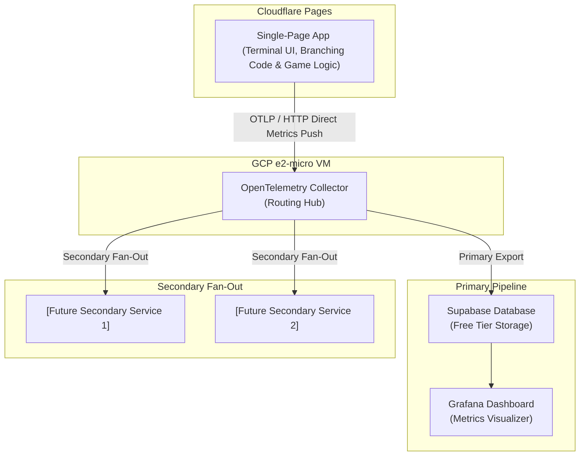

# Architecture Document: Single-Page Text Adventure & Multi-Destination Telemetry Pipeline

## System Overview

The application is structured as a client-side Single Page Application (SPA) deployed to Cloudflare Pages. It integrates game execution logic and branching code directly within the application, while leveraging a decoupled `content.json` payload strictly for narrative text and strings. Client-side telemetry is dispatched directly to an independent, multi-purpose OpenTelemetry (OTEL) collector hosted on a free-tier GCP e2-micro instance, which fans out metrics to primary storage and secondary analysis endpoints.

### 2. Component Architecture

- **Frontend UI Shell:**
  - Retro terminal emulator
  - Self-contained local state loop in the single-page application handling command inputs, text history output, and game state locally in the browser.
- **Game Engine:**
  - Pure execution logic.
  - Handles state management, command parsing, inventory checks, condition evaluation, and dynamic DOM rendering without embedding narrative strings.
- **Content Payload (`content.json`):**
  - Fully populated and finalized data payload
- **Telemetry (`src/engine/telemetry.ts`):**
  - OpenTelemetry metrics instrumentation (`the-library-engine` meter) integrated into the game engine with graceful fallback when collectors are absent or unreachable.
  - Emits monotonic counters for completed runs (`game.runs.completed` with `outcome` and `final_stage` attributes) and fatal transitions (`game.deaths` with `stage`, `death_type`, and `node_id` attributes).
  - Exports metrics over OpenTelemetry Protocol (OTLP) Hypertext Transfer Protocol (HTTP) (`OTLPMetricExporter` targeting `https://collector.littlefuzzydinos.com/v1/metrics`) via a `PeriodicExportingMetricReader` (`5000ms` interval), and invokes `flushTelemetry()` (`meterProvider.forceFlush()`) on `recordRunCompleted()` so terminal outcomes flush immediately.

---

## Architecture Diagram

