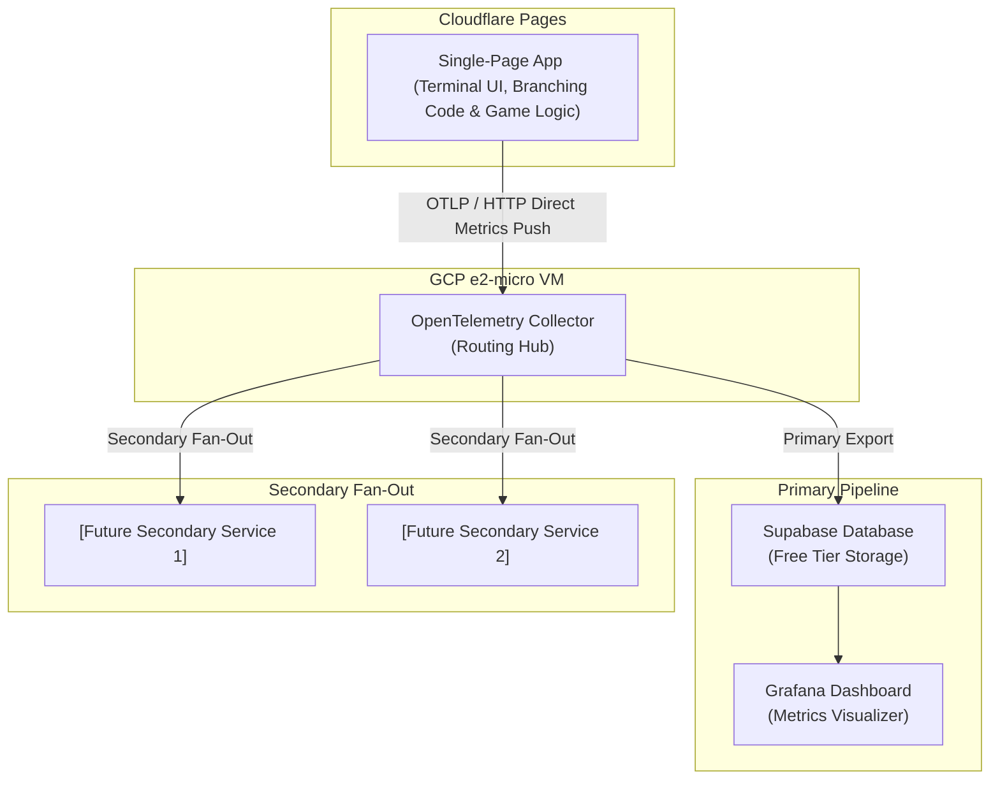

# Architecture Document: Single-Page Text Adventure & Multi-Destination Telemetry Pipeline

## System Overview
The application is structured as a client-side Single Page Application (SPA) deployed to Cloudflare Pages. It integrates game execution logic and branching code directly within the application, while leveraging a decoupled `content.json` payload strictly for narrative text and strings. Client-side telemetry is dispatched directly to an independent, multi-purpose OpenTelemetry (OTEL) collector hosted on a free-tier GCP e2-micro instance, which fans out metrics to primary storage and secondary analysis endpoints.

---

## Architecture Diagram

---

## Component Specifications

1. **Client SPA (Cloudflare Pages @ `thelibrary.littlefuzzydinos.com`)**
   - **UI & Logic Container**: A unified single-page application combining the Lovable-generated terminal visual shell with core execution code, state management, command parsing, and DOM rendering.
   - **Branching Code**: All decision trees and game logic execute natively in the application code.
   - **Content Payload (`content.json`)**: Decoupled narrative text strings and descriptions populated dynamically by the engine.
   - **Client Instrumentation**: Native OTLP metric exporter dispatching game outcome events (lived/died and manner of death) upon reaching terminal nodes.

2. **Telemetry Pipeline (GCP e2-micro VM)**
   - **OTEL Collector**: An independent, always-free routing hub configured with standard OTLP receivers to ingest metrics from the game (and extensible to future applications).
   - **Fan-Out Exporters**: Configured to export metrics concurrently to primary persistent storage and placeholder secondary endpoints to showcase multi-destination telemetry routing.

3. **Analytics & Visualization Layer**
   - **Supabase**: Free-tier PostgreSQL database storing incoming session metrics.
   - **Grafana**: Public-facing analytics dashboard rendering player survival trends and failure distribution metrics.
   - **Secondary Service Placeholders**: Abstracted export slots reserved for additional downstream platforms.